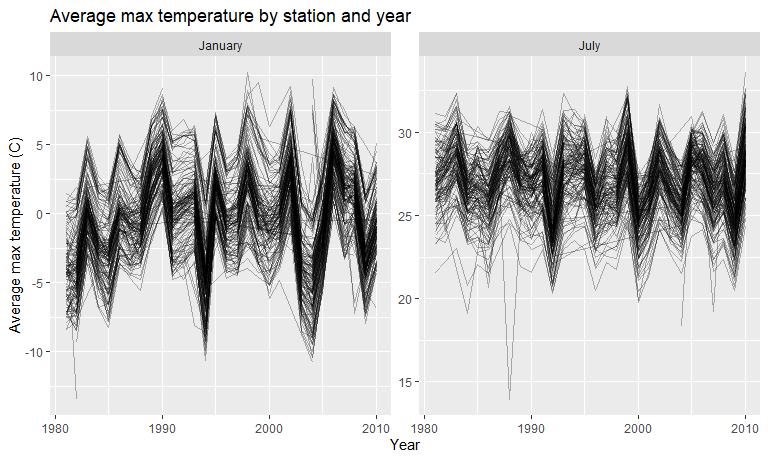
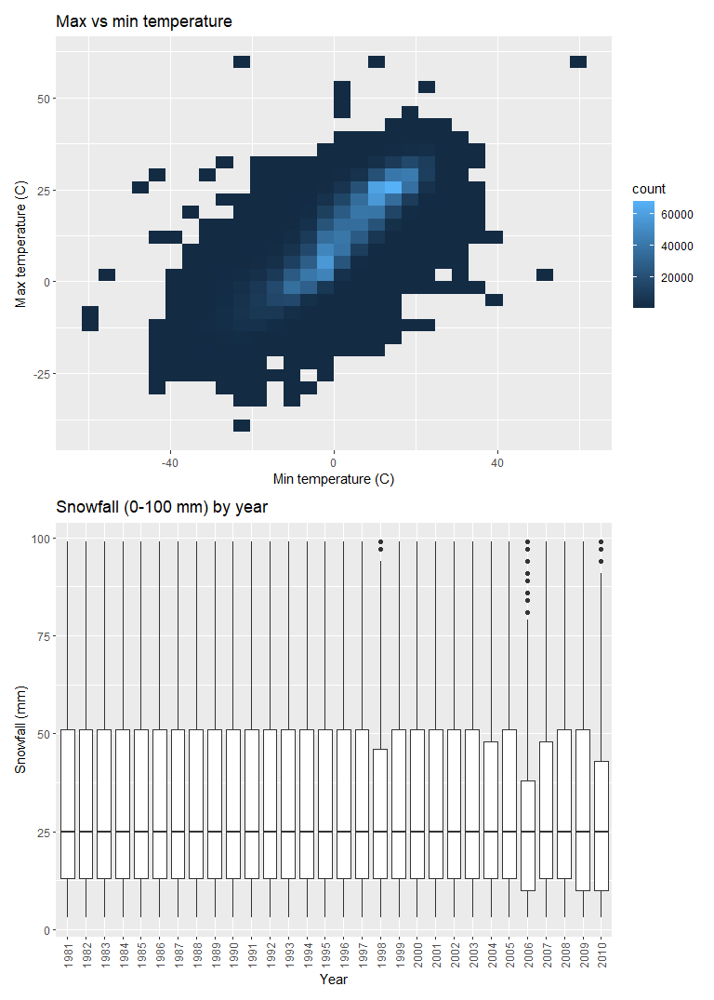
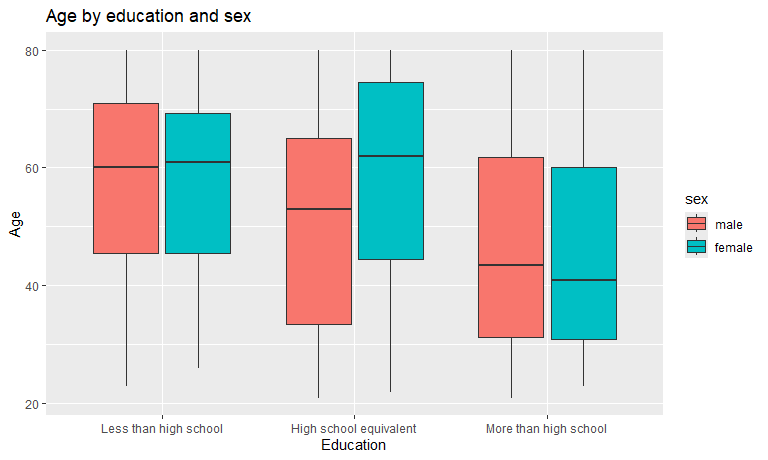
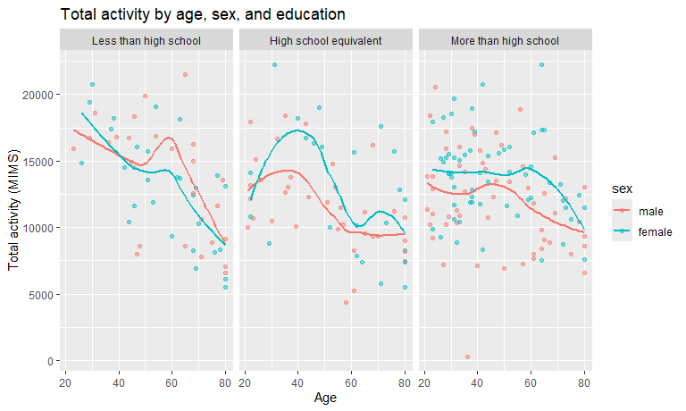
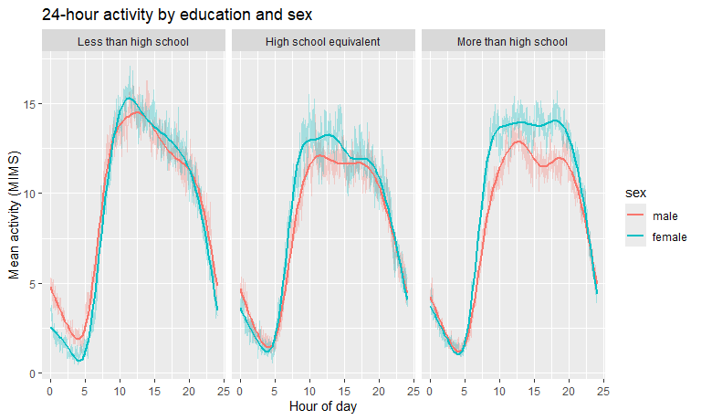
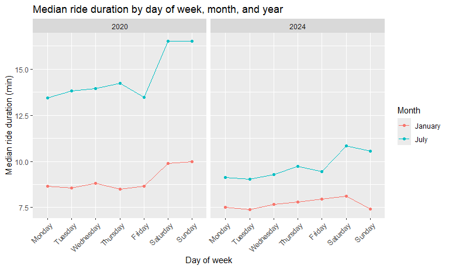
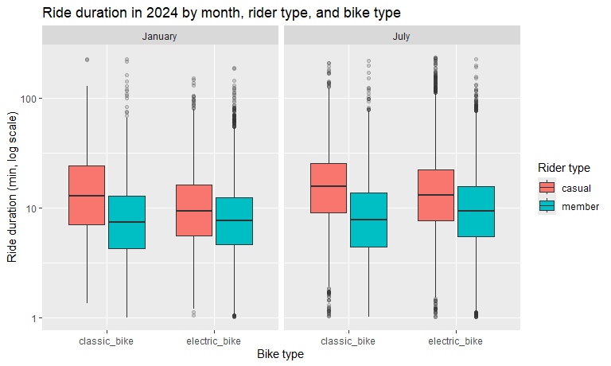

p8105_hw3_qc2385
================
Qixuan Cao qc2385
2026-10-14

``` r
knitr::opts_chunk$set(collapse = TRUE, message = FALSE)

knitr::opts_chunk$set(
  collapse = TRUE, message = FALSE,
  fig.width = 8, fig.asp = 0.6, out.width = "90%")
```

## Problem 0

This homework is organized as an R Project linked to a public GitHub
repository.

``` r
library(tidyverse)
library(p8105.datasets)
library(patchwork)
```

## Problem 1

``` r
data("ny_noaa")
```

The `ny_noaa` data has 2595176 rows and 7 columns. Each row is one day
of weather data from one station in New York. Key variables are station
`id`, `date`, precipitation (`prcp`), snowfall (`snow`), snow depth
(`snwd`), and max and min temperature (`tmax`, `tmin`).

``` r
ny_noaa |> 
  summarize(across(everything(), \(x) mean(is.na(x))))
## # A tibble: 1 × 7
##      id  date   prcp  snow  snwd  tmax  tmin
##   <dbl> <dbl>  <dbl> <dbl> <dbl> <dbl> <dbl>
## 1     0     0 0.0562 0.147 0.228 0.437 0.437
```

Missing data is a big issue, especially for maximum and minimum
temperatures, which are both approximately 43.7% missing. Precipitation,
snowfall, and snow depth are approximately 5.62%, 14.7%, and 22.8%
missing. Station IDs and dates have no missing values. The amount of
missing data varies across weather measurements and should be considered
in subsequent analyses.

### Problem 1 A

``` r
noaa_df = 
  ny_noaa |> 
  separate(date, into = c("year", "month", "day"), 
           sep = "-", convert = TRUE) |> 
  mutate(
    tmax = as.numeric(tmax) / 10,
    tmin = as.numeric(tmin) / 10,
    prcp = prcp / 10)
```

We split `date` into `year`, `month`, and `day`. Temperature is
converted from tenths of degrees C to degrees C, and precipitation from
tenths of mm to mm. Snowfall is already in mm.

``` r
noaa_df |> 
  count(snow, sort = TRUE)
## # A tibble: 282 × 2
##     snow       n
##    <int>   <int>
##  1     0 2008508
##  2    NA  381221
##  3    25   31022
##  4    13   23095
##  5    51   18274
##  6    76   10173
##  7     8    9962
##  8     5    9748
##  9    38    9197
## 10     3    8790
## # ℹ 272 more rows
```

The most common snowfall value is 0, because most days have no snow.
Missing (`NA`) is the second most common. Among other values, 25, 13,
and 51 are most common. This suggests snowfall was often measured in
inches and then converted to mm.

### Problem 1 B

``` r
noaa_df |> 
  filter(month %in% c(1, 7), !is.na(tmax)) |>
  mutate(month = factor(month, levels = c(1, 7), labels = c("January", "July"))) |> 
  group_by(id, year, month) |> 
  summarize(mean_tmax = mean(tmax, na.rm = TRUE)) |> 
  ggplot(aes(x = year, y = mean_tmax, group = id)) + 
  geom_line(alpha = 0.3) + 
  facet_wrap(~ month, scales = "free_y") + 
  labs(
    title = "Average max temperature by station and year",
    x = "Year",
    y = "Average max temperature (C)")
```



July is much warmer than January. Average max temperature is mostly
between -10 and 10 C in January and between 20 and 33 C in July.
Stations rise and fall together from year to year, so differences across
years are mostly shared across stations. January varies more across
years than July. There are a few outliers, such as one station around
-13 C in January in the early 1980s and one station around 14 C in July
in the late 1980s.

### Problem 1 C

``` r
tmax_tmin_p = 
  noaa_df |> 
  drop_na(tmax, tmin) |> 
  ggplot(aes(x = tmin, y = tmax)) + 
  geom_bin2d() + 
  labs(
    title = "Max vs min temperature",
    x = "Min temperature (C)",
    y = "Max temperature (C)")

snow_p = 
  noaa_df |> 
  filter(snow > 0, snow < 100) |> 
  ggplot(aes(x = factor(year), y = snow)) + 
  geom_boxplot() + 
  labs(
    title = "Snowfall (0-100 mm) by year",
    x = "Year",
    y = "Snowfall (mm)") + 
  theme(axis.text.x = element_text(angle = 90, vjust = 0.5))

tmax_tmin_p / snow_p
```


Max and min temperature are strongly positively related, and most
observations are between about -15 and 30 C. There are some unlikely
values, such as max temperatures near 60 C and min temperatures below
-50 C, which are probably data errors.

Among days with snowfall greater than 0 and less than 100 mm, the
distributions are similar across years. These boxplots show daily
snowfall within this range, rather than total annual snowfall.

## Problem 2

#### Tidy data

``` r
covar_df = 
  read_csv("data/nhanes_covar.csv", skip = 4) |> 
  janitor::clean_names() |> 
  filter(age >= 21) |> 
  drop_na() |> 
  mutate(
    sex = factor(sex, levels = c(1, 2), labels = c("male", "female")),
    education = factor(
      education, 
      levels = c(1, 2, 3), 
      labels = c("Less than high school", "High school equivalent", "More than high school")))

accel_df = 
  read_csv("data/nhanes_accel.csv") |> 
  janitor::clean_names()

nhanes_df = 
  inner_join(covar_df, accel_df, by = "seqn")
```

We remove participants younger than 21 and those with missing
demographic data, and convert `sex` and `education` to factors. The
demographic and accelerometer data are merged by `seqn`. The final
dataset has 228 participants and 1445 variables.

### Sex and education

``` r
nhanes_df |> 
  count(education, sex) |> 
  pivot_wider(names_from = sex, values_from = n) |> 
  knitr::kable()
```

| education              | male | female |
|:-----------------------|-----:|-------:|
| Less than high school  |   27 |     28 |
| High school equivalent |   35 |     23 |
| More than high school  |   56 |     59 |

``` r
nhanes_df |> 
  ggplot(aes(x = education, y = age, fill = sex)) + 
  geom_boxplot() + 
  labs(
    title = "Age by education and sex",
    x = "Education",
    y = "Age")
```


The “More than high school” group is the largest for both men and women.
Numbers of men and women are similar in each group, except in “High
school equivalent”, which has more men (35) than women (23).

Participants with more than high school education tend to be younger,
with median age around 41 to 44. In the “High school equivalent” group,
women are older than men (median about 62 vs. 53). In the other two
groups, the age distributions of men and women are similar.

#### Total activity

``` r
nhanes_df |> 
  mutate(total_activity = rowSums(across(min1:min1440))) |> 
  ggplot(aes(x = age, y = total_activity, color = sex)) + 
  geom_point(alpha = 0.5) + 
  geom_smooth(se = FALSE) + 
  facet_wrap(~ education) + 
  labs(
    title = "Total activity by age, sex, and education",
    x = "Age",
    y = "Total activity (MIMS)")
```


Total activity generally decreases with age in all three education
groups. Women tend to be more active than men in the “High school
equivalent” and “More than high school” groups, especially at younger
and middle ages. In the “Less than high school” group, men and women are
similar overall, with men slightly more active around age 60. The trend
lines are wiggly in some places because each group has a small number of
participants.

### 24-hour activity

``` r
nhanes_df |> 
  pivot_longer(
    min1:min1440,
    names_to = "minute",
    names_prefix = "min",
    names_transform = as.numeric,
    values_to = "mims") |> 
  group_by(education, sex, minute) |> 
  summarize(mean_mims = mean(mims)) |> 
  ggplot(aes(x = minute / 60, y = mean_mims, color = sex)) + 
  geom_line(alpha = 0.3) + 
  geom_smooth(se = FALSE) + 
  facet_wrap(~ education) + 
  labs(
    title = "24-hour activity by education and sex",
    x = "Hour of day",
    y = "Mean activity (MIMS)")
```


All groups show a similar daily pattern: activity is lowest around 4 to
5 am, rises quickly in the morning, stays high during the day, and drops
in the evening. In the “Less than high school” group, activity peaks
around noon and then slowly declines, and men and women are similar
during the day. In the other two groups, activity stays high for longer
during the day, and women are more active than men, especially in the
“More than high school” group.

## Problem 3

### Import and tidy data

``` r
citi_df = 
  bind_rows(
    read_csv("data/citibike/Jan 2020 Citi.csv.zip") |> mutate(year = 2020, month = "January"),
    read_csv("data/citibike/July 2020 Citi.csv.zip") |> mutate(year = 2020, month = "July"),
    read_csv("data/citibike/Jan 2024 Citi.csv.zip") |> mutate(year = 2024, month = "January"),
    read_csv("data/citibike/July 2024 Citi.csv.zip") |> mutate(year = 2024, month = "July")) |> 
  janitor::clean_names() |> 
  mutate(
    month = factor(month, levels = c("January", "July")),
    weekdays = factor(
      weekdays, 
      levels = c("Monday", "Tuesday", "Wednesday", "Thursday", "Friday", "Saturday", "Sunday")))
```

Combine the four files and add `year` and `month`. The final dataset has
99485 rides and 9 variables. Each row is one ride. Key variables are
bike type (`rideable_type`), day of the week (`weekdays`), ride duration
in minutes (`duration`), start and end station, and rider type
(`member_casual`).

### Rides by year and month

``` r
citi_df |> 
  count(year, month, member_casual) |> 
  pivot_wider(names_from = member_casual, values_from = n) |> 
  knitr::kable()
```

| year | month   | casual | member |
|-----:|:--------|-------:|-------:|
| 2020 | January |    984 |  11436 |
| 2020 | July    |   5637 |  15411 |
| 2024 | January |   2108 |  16753 |
| 2024 | July    |  10894 |  36262 |

Members take most rides in every month. Rides are much higher in July
than in January, and much higher in 2024 than in 2020; July 2024 has the
most rides (36262 member and 10894 casual). Casual riders are a larger
share of rides in July than in January, which suggests casual riders use
Citi Bike more in summer.

### Top starting stations in July 2024

``` r
citi_df |> 
  filter(year == 2024, month == "July") |> 
  count(start_station_name, sort = TRUE) |> 
  head(5) |> 
  knitr::kable(col.names = c("Starting station", "Number of rides"))
```

| Starting station         | Number of rides |
|:-------------------------|----------------:|
| Pier 61 at Chelsea Piers |             163 |
| University Pl & E 14 St  |             155 |
| W 21 St & 6 Ave          |             152 |
| West St & Chambers St    |             150 |
| W 31 St & 7 Ave          |             146 |

The most popular starting station in July 2024 is Pier 61 at Chelsea
Piers (163 rides), followed by University Pl & E 14 St (155 rides), W 21
St & 6 Ave (152 rides), West St & Chambers St (150 rides), and W 31 St &
7 Ave (146 rides).

### Median ride duration

``` r
citi_df |> 
  group_by(year, month, weekdays) |> 
  summarize(median_duration = median(duration)) |> 
  ggplot(aes(x = weekdays, y = median_duration, color = month, group = month)) + 
  geom_point() + 
  geom_line() + 
  facet_wrap(~ year) + 
  labs(
    title = "Median ride duration by day of week, month, and year",
    x = "Day of week",
    y = "Median ride duration (min)",
    color = "Month") + 
  theme(axis.text.x = element_text(angle = 45, hjust = 1))
```



Rides are longer in July than in January in both years. Median duration
is shorter in 2024 than in 2020, especially in July (about 9 to 11
minutes in 2024， 13 to 17 minutes in 2020). Weekend rides are usually
longer than weekday rides.

### Ride duration in 2024

``` r
citi_df |> 
  filter(year == 2024) |> 
  ggplot(aes(x = rideable_type, y = duration, fill = member_casual)) + 
  geom_boxplot(outlier.alpha = 0.2) + 
  facet_wrap(~ month) + 
  scale_y_log10() + 
  labs(
    title = "Ride duration in 2024 by month, rider type, and bike type",
    x = "Bike type",
    y = "Ride duration (min, log scale)",
    fill = "Rider type")
```



Casual riders take longer rides than members for both bike types and
both months. In July the median is about 13 to 16 minutes for casual
riders and 8 to 9 minutes for members. Rides are longer in July than in
January. For casual riders, electric bike rides are shorter than classic
bike rides. For members, the two bike types are similar in January, and
electric bike rides are slightly longer in July.
